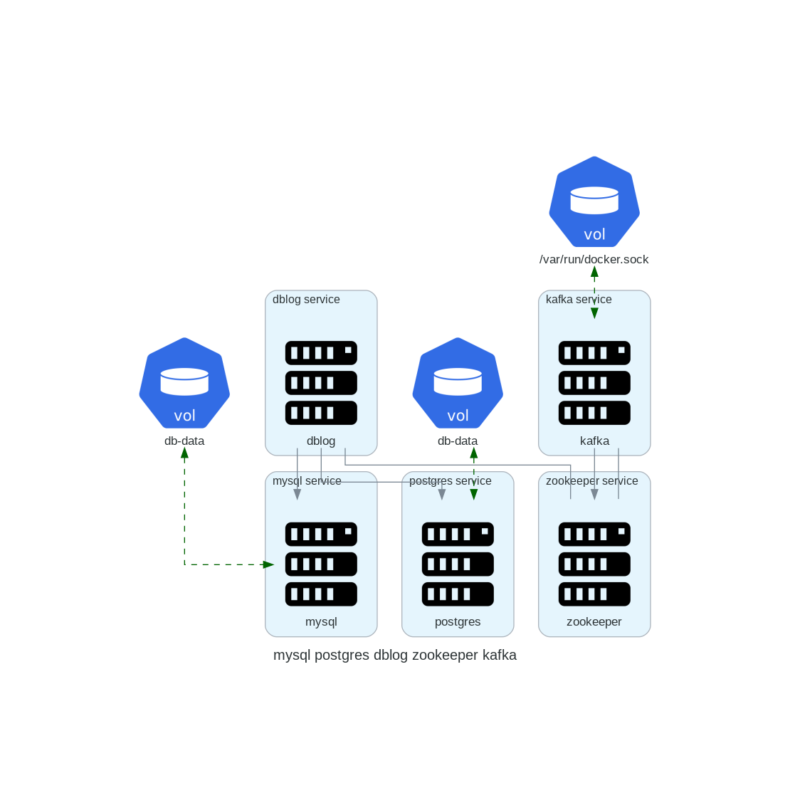

# compose-diagrams
Create architecture diagrams of distributed systems from docker-compose files.

`compose-diagrams` reads multi-container [Docker Compose](https://docs.docker.com/compose/) `.yaml` files and outputs a diagram `.png` image representing the Docker Compose file.
  
```
  ┌────────────────────┐       ┌────────────────────┐
  │ Docker Compose     │       │ Diagram .png image │
  │ .yaml file         │       │                    │
  │────────────────────│       │            ┌───┐   │
  │ version: 'x.y'     │       │  ┌───┐ --- │   │   │
  │ services:          │  ══>  │  │   │     └───┘   │
  │   service X:       │       │  └───┘ \           │
  │     params...      │       │         \ ┌───┐    │
  │   service Y:       │       │           │   │    │
  │ ...                │       │           └───┘    │
  └────────────────────┘       └────────────────────┘
```

## Setting up

compose-diagrams needs [Python 3](https://www.python.org/) >= 3.9 and [Graphviz](https://graphviz.org/download/) (the `dot` command) installed.

Then, from the project folder:
```
$ python3 -m venv .venv
$ source .venv/bin/activate
$ pip install .
```

This also installs [Diagram as Code](https://diagrams.mingrammer.com/) and [PyYAML](https://pyyaml.org/).

## Running

```
$ compose-diagrams docker-compose.yaml
```

The command reads the Docker Compose file and writes `docker-compose.png` in the current folder. Some options:

```
$ compose-diagrams docker-compose.yaml -o output/my-system.svg   # output path and format
$ compose-diagrams docker-compose.yaml -d LR                     # left-to-right layout
$ compose-diagrams docker-compose.yaml -s c4                     # C4 container diagram
$ compose-diagrams docker-compose.yaml --script                  # also print the Diagram as Code script
$ compose-diagrams --help
```

Supported formats are `png`, `svg`, `pdf` and `jpg`. Sample input files are in the `docker-compose-files` folder.

## Docker

With Docker, there is no need to install Python or Graphviz. Build the image from the project folder:

```
$ docker build -t compose-diagrams .
```

Start the web interface and open http://localhost:8000:

```
$ docker run --rm -p 8000:8000 compose-diagrams
```

Or use the command line, mounting the folder that holds your Compose file as `/work`:

```
$ docker run --rm -v "$PWD":/work compose-diagrams docker-compose.yaml -o diagram.png
$ docker run --rm -v "$PWD":/work compose-diagrams docker-compose.yaml -s c4 -o diagram.svg
```

The diagram is written to the same folder. On Linux, add `--user "$(id -u):$(id -g)"` so the file belongs to you rather than to root.

## C4 style

With `-s c4` (or the Style selector in the web interface), the diagram follows the [C4 model](https://c4model.com/) container view, using the [C4 nodes](https://diagrams.mingrammer.com/docs/nodes/c4) of Diagram as Code:

- the Compose project is the system boundary (named after the file's `name`, when it has one);
- each service is a container, labelled with its image (or build context) and published ports;
- services running a known data store image (postgres, mysql, redis, mongo…) and named volumes are drawn as databases;
- `depends_on`, `links` and volume usage become labelled relationships.

Bind mounts (host paths) are left out of the C4 diagram.

## Web interface

```
$ compose-diagrams --web
```

This starts a local web page at http://127.0.0.1:8000 and opens it in the browser. Type, paste or drop a Docker Compose file on the left and the diagram on the right follows your edits. From there you can change the style and the layout direction, and download the diagram as PNG, SVG or PDF. Press `Ctrl+C` in the terminal to stop it.

```
$ compose-diagrams docker-compose.yaml --web   # start with this file loaded
$ compose-diagrams --web --port 9000           # use another port
$ compose-diagrams --web --no-browser          # do not open the browser
$ compose-diagrams --web --host 0.0.0.0        # accept connections from other machines
```

The page runs entirely on your machine: the Compose file is not sent anywhere else.

## Example

### Input

A Docker Compose `.yaml` file.

```
version: '3.8'
services:
  mysql:
    image: mysql
    ports:
     - 3306:3306
    environment:
     - MYSQL_ROOT_PASSWORD=secret
     - MYSQL_USER=mysqluser
     - MYSQL_PASSWORD=mysqlpw
    volumes:
      - db-data:/var/lib/mysql
  postgres:
    image: postgres:9.4
    volumes:
      - db-data:/var/lib/postgresql/data
  dblog:
    build:
      context: api
      dockerfile: Dockerfile
      container_name: dblog
    restart: always
    ports:
      - "9001:9001"
    depends_on:
      - mysql
      - postgres
    links:
      - zookeeper
  zookeeper:
    image: debezium/zookeeper:${DEBEZIUM_VERSION}
    ports:
     - 2181:2181
     - 2888:2888
     - 3888:3888
  kafka:
    build:
      context: kafka
      dockerfile: Dockerfile
      container_name: kafka
    links:
      - zookeeper
    ports:
      - "9092:9092"
    environment:
      KAFKA_ADVERTISED_HOST_NAME: $CF_HOST_IP
      KAFKA_ZOOKEEPER_CONNECT: zk:2181
      KAFKA_MESSAGE_MAX_BYTES: 2000000
      KAFKA_CREATE_TOPICS: "Topic1:1:1"
    volumes:
      - /var/run/docker.sock:/var/run/docker.sock
    depends_on:
      - zookeeper
volumes:
  db-data:
```

### Output

A `.png` image file.




